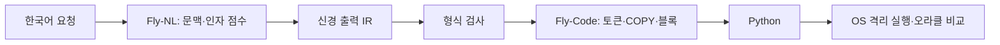

# 두 Fly 모델 v2: 구조와 재현 절차

## 생성 경로



`models/neural_sequence.py`가 공통 엔진이며, `models/fly_nl.py`와 `models/fly_code_v2.py`는 각각 독립적인 `Brain`과 체크포인트를 갖는다. 그래프는 2,048개 실제 뉴런과 5,340개 원본 방향성 간선이다. 같은 해부학적 인덱스를 사용하지만 시냅스 배열·난수 시드·데이터·optimizer는 공유하지 않는다. B 시드는 0, A 시드는 101이다.

각 선택은 입력 자극을 원본 간선에 4번 반복 전달한 rate 활동에서 나온다. 연결 수가 많은 **두 출력 뉴런**을 고정 readout으로 사용한다. Python/IR 토큰과 제어 동작은 이진 시간 슬롯으로 예측한다. A의 문맥 후보·원문 span 후보는 같은 신경망의 양성 점수를 각각 읽고 argmax로 고른다. 별도 학습 출력층이나 임베딩 가중치는 없다.

## 고정 I/O와 학습 경계

Fly-Code의 입력은 IR v0.1 문법 리터럴의 고정 ID와 원문 COPY 후보의 위치다. 이름·숫자·문자열은 불투명한 값으로 부호화하고 원본 바이트를 COPY 저장소에 보존한다. **IR 토큰→Python 대응표는 없다.** 어떤 바이트를 출력하고 어떤 위치를 복사할지는 신경망이 선택한다. 새로운 변수 길이가 출력 접두사의 위치를 바꾸던 v1 문제를 이 방식으로 제거했다.

Fly-NL은 UTF-8, 공백/인용부호 경계, 고정된 불투명 바이트 해시, 위치·출력 상태를 입력한다. 언어별 단어 뜻 사전·정규식 의도 분류·외부 임베딩은 사용하지 않는다. 큰따옴표 리터럴과 정수 리터럴의 내용은 I/O에서 보존하고, 값 대신 경계/위치 자극을 제공한다. 전체 span 또는 인용부호 안쪽 span 중 어느 것을 복사할지도 뉴런 점수로 선택한다.

A는 먼저 숫자 문맥 ID를 예측하고 인자 span들을 임시 레지스터에 바인딩한다. 이후 같은 그래프가 IR의 리터럴·공백·개행·레지스터 COPY를 예측한다. **문맥 ID→완성 IR 템플릿은 없다.** 레지스터는 신경망이 고른 포인터를 보존할 뿐이다. `tests/test_neural_memory.py`는 문맥을 지정해도 출력 바이트가 자동 생성되거나 교정되지 않음을 확인한다.

B의 NEXT/PUSH/POP 역시 신경 출력이다. I/O 드라이버는 숫자 커서·깊이를 변경하지만 들여쓰기·콜론·개행을 자동으로 넣지 않는다. 지시어 `END`를 해석해서 Python을 완성하는 코드도 드라이버에 없다. 미리 정의한 문법 리터럴, COPY 후보, 프로토콜 해석은 고정 I/O이며 **학습되는 선택은 원본 그래프 간선 강도에만 저장**된다.

출력마다 신경 상태를 초기화하고 원문/이전 신경 선택/임시 상태를 다시 자극한다. 이것은 장기 기억을 생물학적으로 재현한 모델이 아니라, 고정 I/O 메모리를 가진 인공 신경 계산 모델이다. 문맥·포인터·토큰별 실제 뉴런 ID, rate, 확률, 활동 해시, 시냅스 해시를 trace에서 볼 수 있다.

## 학습과 부호 가정

희소 CSR BPTT의 감독 gradient를 원본 간선에만 적용한다. Adam 워밍업 후 bounded L-BFGS-B로 같은 간선 벡터를 최적화한다. v2에서는 강도를 `[-3,3]`으로 제한하되 부호 변경을 허용한다. 원본 데이터에 신경전달물질 정보가 없으므로 이는 **생리학적 제약을 검증한 학습법이 아니다.** 초기 억제성 비율 20%도 인공 가정이다. v1의 부호 보존 모드는 기본값으로 유지한다.

훈련용 자극의 정확 중복은 제거하며, 같은 자극에 상충하는 정답이 있으면 실패한다. 이 캐시는 학습 입력/레이블 저장용이고 생성 경로에서 접근하지 않는다. 체크포인트는 역할, encoder/I/O 프로토콜, IR/데이터/그래프 해시를 검사한다. 기존 간선 외 계수·예문별 정답 검색 메모리는 생성에 사용하지 않는다. 외부 모델·legacy 번역기·teacher 모듈의 생성 경로 import를 차단한다.

신경 출력과 희소 배치 계산의 확률/gradient 일치를 테스트한다. A/B의 역할을 바꿔 읽거나 같은 시냅스 메모리를 공유하면 실패한다. 체크포인트 복원 추론은 두 모델 모두 정확히 일치했다.

## 평가 데이터와 한계

| 단계 | train / validation / test | 분리 기준 |
| --- | --- | --- |
| B | 384 / 96 / 96 | 24개 제한된 프로그램 유형 × 서로 다른 이름·상수 그룹 |
| B 조합 | 별도 4개 | 새 누적 조건/연산 조합·반복 경계, 훈련과 선택에 미사용 |
| A | 576 / 36 / 36 | train 표현 0~3, validation 표현 4, test 표현 5; 이름·수치 그룹도 분리 |

B 데이터는 대입, 숫자/문자열 출력, 산술, 조건 분기, FOR, 함수, RETURN, 중첩 누적을 포함한다. 함수는 여러 인자 값·음수·0·경계 입력에서 검사한다. 24개 유형은 독립 알고리즘 계열 24개를 의미하지 않는다. B의 다른 이름/수치 평가는 표면 일반화다. 별도 미학습 조합은 3/4를 통과했고, 새 연산/깊이 조합 하나는 실패했다.

A는 정수·문자열 출력, 대입, 대입 후 출력, 더한 뒤 출력, 항등 함수, 두 인자 합 함수, 끝 제외 구간 출력의 8종 과제와 불확실 결과를 다룬다. **식별자는 JSON 큰따옴표, 수치·조사는 공백으로 구분**한다. 영어·붙여 쓴 수치/조사·임의의 복합 조건은 아직 평가하지 않았다.

A test는 9개 새로운 표현 형태(지원 과제 8종 + 미지원 1종)에 이름/수치 4개 그룹을 적용한 36개 사례다. 이를 36개 독립 의도나 범용 언어 이해 성과로 해석하지 않는다. IR 토큰 유사도·형식·구조·정확한 의미를 별도로 보고한다. 다른 적법한 IR 표현을 완전한 의미 동치로 판단하는 평가기는 아직 없으므로 IR 의미 점수는 정답 IR과의 정규화 일치를 사용한다. 종단에서는 실제 Python 실행을 별도로 확인한다.

validation으로 체크포인트를 고르고 test는 선택 후 한 번 연다. 열린 study에는 재학습·추가 최적화·재채점을 거부한다. 이후 개선은 새 평가 버전을 사용해야 한다. 현재 전체 언어 모델 비교는 단일 시드이며, 5개 시드 증거는 toy task에 해당한다. 실제 배선이 무작위 배선보다 우수하다는 주장은 하지 않는다.

## Linux에서 재현

```bash
python -m pip install -r requirements.txt
python -m unittest -v
python benchmark.py
python -m evaluation.toy --free-signs --output artifacts/toy-signed
OPENBLAS_NUM_THREADS=1 python -m models.train_sequence --epochs 60 --polish-steps 160 --evaluate-test --output artifacts/code-v2
OPENBLAS_NUM_THREADS=1 python -m models.train_nl --epochs 60 --polish-steps 160 --evaluate-test --output artifacts/nl-v2
python -m evaluation.end_to_end --output artifacts/e2e-v2
python dual_fly.py --ir "PRINT 37"
python dual_fly.py --goal '37 을 출력해'
```

코드 실행 채점에는 `bubblewrap`과 `/usr/bin/python3`가 필요하다. 네트워크·host workspace/home를 숨긴 읽기 전용 namespace, CPU/메모리/프로세스/출력 제한을 사용한다. 격리가 없으면 호스트 실행으로 대체하지 않는다.

`--tests oracle.json`으로 사용자 오라클을 줄 수 있다. 예를 들어 `{"stdout":"37\n","variables":{}}`를 전달하면 실제 출력과 비교한다. 오라클 없이 자연어를 생성할 때의 `syntax_only`는 의미 정답 판정이 아니다. `--trace`로 두 모델의 실제 선택 근거를 출력한다. v1은 `--engine v1`과 최초 체크포인트/데이터 경로로 유지한다.

전체 가중치·trace는 `artifacts/`에 남기고, 작은 검토 결과는 `python -m evaluation.snapshot_v2 --test-log /tmp/codingfly-final-v2-tests.log`로 저장한다. 코드/라이브러리/플랫폼·dirty 소스 해시·모델 해시는 각 보고서에 기록된다. [잠긴 평가 자료](../experiments/locked/)와 [실측 결과](IMPLEMENTATION_RESULTS.md)를 함께 확인한다.
